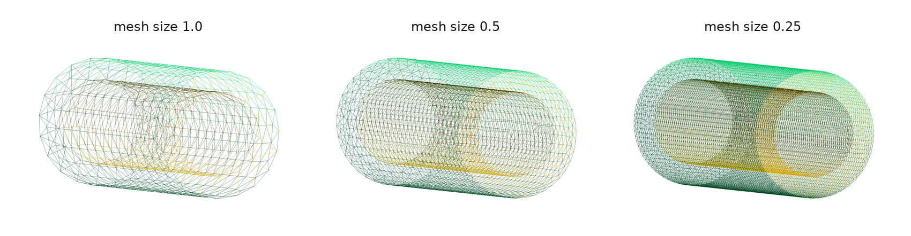
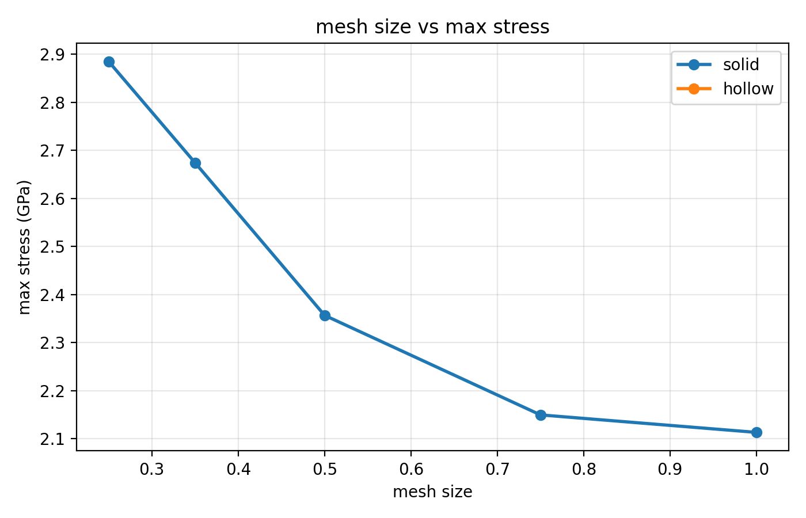

# Automated FreeCAD-Gmsh-FEBio pipeline

A Python pipeline that goes from geometry parameters to finite element
results without any manual steps in between. I built it for my BSc thesis in
Computer Science at the University of Amsterdam ([PDF](docs/thesis.pdf)). The
idea behind it is to make simulations of vascular stents easier to repeat.

```text
FreeCAD -> STEP -> Gmsh -> MSH -> pyfebio -> FEBio -> XPLT -> HDF5 -> results
```

The main pipeline uses solid and hollow cylinders. Their stiffness can be
calculated by hand, so I used them to check that the whole workflow gives
correct results. A separate script meshes an imported stent geometry, selects
its inner surface and runs a FEBio pressure simulation on it.


## Key results

- The simulated stiffness of both cylinders is within 0.13% of the
  theoretical value E·A/L (see the table below).
- Changing the wall thickness or Young's modulus in `config.py` creates a new
  geometry, mesh and FEBio model, and the results change the way theory
  predicts.
- The stiffness converges when the mesh gets finer, but the maximum stress
  does not (see [Known limitations](#known-limitations)).
- The stent script meshes a 97,261-element model and the pressure simulation
  runs to the end.

## Features

- parameterised solid and hollow cylinder generation in FreeCAD;
- three-dimensional Gmsh meshing with named volume and surface regions;
- compression and internal-pressure FEBio model generation with pyfebio;
- command-line FEBio execution and automatic result extraction;
- mesh-convergence, Young's-modulus and cylinder-thickness studies;
- plots generated from the study CSV files;
- a separate imported-stent meshing and pressure-simulation route.

## Requirements

- Python 3.11 or newer;
- FreeCAD with command-line Python support;
- FEBio 4, with the `febio4` executable available;
- the Python packages in `requirements.txt`.

Create and activate a virtual environment, then install the dependencies:

```bash
python3 -m venv venv
source venv/bin/activate
python -m pip install -r requirements.txt
```

The executable locations can be configured when they are not on `PATH`:

```bash
export FREECAD_COMMAND=/path/to/FreeCADCmd
export FEBIO_COMMAND=/path/to/febio4
```

The local development setup may also use
`.tools/freecad-appimage/squashfs-root/AppRun`. The `.tools` directory is not
part of the repository.

## Running the cylinder pipeline

Select the geometry and load case in `config.py`, then run:

```bash
source venv/bin/activate
python main.py
```

The runner performs five steps:

1. generate a cylinder STEP file with FreeCAD;
2. generate and label a Gmsh volume mesh;
3. create the selected FEBio input model;
4. run FEBio;
5. convert the XPLT output to HDF5 and print a result summary.

The main generated files are written to:

```text
freecad_step/cylinder.step
gmsh_step/cylinder.msh
febio_step/jobs/cylinder/
```

Generated geometry, meshes, solver jobs and study results are ignored by Git.

## Configuration

The main settings are in `config.py`:

- geometry: cylinder type, outer radius, inner radius and height;
- mesh: target size, element order and MSH version;
- material: Young's modulus, Poisson's ratio and density;
- load case: compression or internal pressure;
- FEBio: time steps, step size and output stride.

Study scripts temporarily override selected settings through environment
variables. The default configuration file is not rewritten.

FEBio's default automatic time stepper may increase the configured step size
when a simulation converges easily. The number of completed solver increments
can therefore be lower than the configured number of nominal time steps.

## Parameter studies

Each study runs the main compression pipeline repeatedly and writes a CSV file
to `study_results/`:

```bash
python studies/mesh_convergence.py
python studies/youngs_modulus.py
python studies/cylinder_thickness.py
```

Generate all study plots with:

```bash
python studies/make_plots.py
```

## Imported stent route

The included stent input geometry is stored as `stent.step`. It is run
separately because it does not use the FreeCAD cylinder-generation stage:

```bash
python gmsh_step/mesh_stent_selection.py
python febio_step/create_stent_pressure_feb.py
cd febio_step/jobs/stent
febio4 -i pressure_stent.feb
```

The Gmsh script creates a volume mesh and selects the inner and outer
cylindrical surfaces from their geometry. The FEBio script applies pressure to
the labelled inner wall and uses a dynamic analysis without support nodes.
This route demonstrates that the meshing and simulation stages can process the
more complex imported geometry, but it is not yet integrated into `main.py`.
Generating the stent mesh can take several minutes.

## Results

All numbers below come from chapter 6 of the thesis. The simulations use
first-order tetrahedral elements and a linear elastic material with
E = 193 GPa and ν = 0.3.

### Stiffness verification

Compression of a cylinder with radius 3 and height 15 (the hollow one has
inner radius 2), with mesh size 0.5. The simulated stiffness is compared with
the theoretical stiffness k = E·A/L:

| Geometry        | Simulated stiffness | Analytical stiffness | Difference |
|-----------------|---------------------|----------------------|------------|
| Solid cylinder  | 3.633 × 10¹¹        | 3.638 × 10¹¹         | −0.13%     |
| Hollow cylinder | 2.022 × 10¹¹        | 2.021 × 10¹¹         | +0.04%     |

In the wall thickness study (0.5 to 2.0) the difference with theory stayed
between −0.09% and +0.16%.

### Mesh convergence



| Solid cylinder                    | Mesh size 1.0 | Mesh size 0.25 |
|-----------------------------------|---------------|----------------|
| Elements                          | 2,293         | 124,136        |
| Run time                          | 2.5 s         | 91.8 s         |
| Stiffness difference from theory  | −0.88%        | +0.004%        |
| Maximum stress                    | 2.11 GPa      | 2.88 GPa       |

<p>
  
  
</p>

The stiffness is based on the total force on the top face and converges.
The maximum stress is a value in a single element and keeps going up (more on
this below).

## Units

FEBio does not use fixed units, so you have to keep them consistent
yourself. Here Young's modulus and pressure are in Pa, so stresses are also
in Pa. Lengths are in model units and are not converted. This means reaction
forces are in Pa × (model unit)² and stiffness in Pa × (model unit). For the
elastic results above this does not matter, because the comparison with
E·A/L works for any length unit. It does matter for density and time, so the
dynamic stent simulation needs a consistent unit system before its numbers
mean anything.

## Known limitations

I noticed some of these after handing in the thesis. The thesis itself has
not been changed.

- The maximum stress does not converge, probably because of a stress
  singularity. The bottom face is fixed in all three directions, so the
  material cannot expand sideways there. Under uniform compression the stress
  should be about E·δ/L ≈ 1.29 GPa, but the maximum keeps going up as the mesh
  gets finer (2.11 → 2.88 GPa). That is what you would expect from a
  singularity at the clamped edge, which does not converge no matter how fine
  the mesh is. In the thesis I assumed the mesh was just not fine enough yet.
  This could be checked by finding the element with the peak stress, or by
  only fixing the bottom face in the z direction.
- The default internal pressure of 2 × 10¹⁰ Pa is far too high for a real
  load. The resulting strains are much larger than a linear elastic model can
  describe.
- The stent simulation is a demonstration, not a validated model. It uses a
  linear elastic material, a dynamic analysis without supports and no contact
  with a vessel wall. A realistic stent model would need plasticity or a
  superelastic material, contact, and a comparison with bench test data.
- The stent route is not part of `main.py` yet.

## Tests

The lightweight tests check the result calculations without requiring FreeCAD
or FEBio:

```bash
python -m unittest discover -s tests
```

An end-to-end run still requires both external programs because it generates
the geometry, mesh and solver output from scratch.

## Project structure

```text
config.py                         shared pipeline settings
main.py                           cylinder pipeline runner
freecad_step/script.py            cylinder geometry generation
gmsh_step/mesh.py                 cylinder meshing and region labels
gmsh_step/mesh_stent_selection.py imported-stent meshing and selection
febio_step/                       FEBio model and result helpers
studies/                          parameter studies and plotting
tests/                            lightweight calculation tests
```
