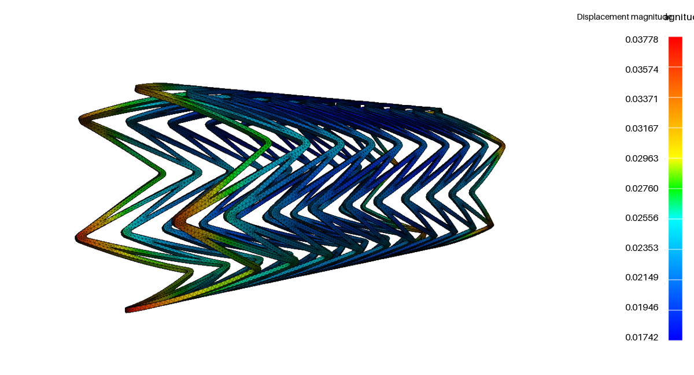
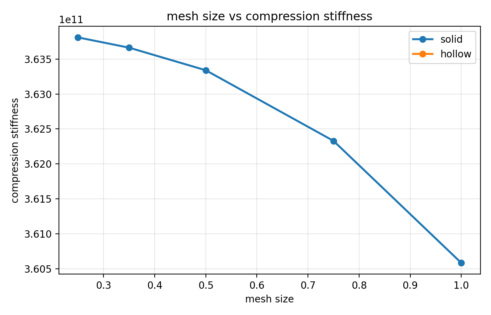

# Automated FreeCAD-Gmsh-FEBio pipeline

An open-source Python pipeline that turns geometry parameters into finite
element results without manual steps in between. It was developed for my BSc
thesis in Computer Science at the University of Amsterdam
([PDF](docs/thesis.pdf)), with vascular stents as the motivating application.

```text
FreeCAD -> STEP -> Gmsh -> MSH -> pyfebio -> FEBio -> XPLT -> HDF5 -> results
```

The reproducible main pipeline uses solid and hollow cylinders, which have an
analytical solution and can therefore be used to verify the workflow. A
separate route meshes an imported stent geometry, selects its inner surface
and runs a FEBio pressure simulation.



## Key results

- **Verified against theory:** simulated axial stiffness is within 0.13% of
  the analytical value E·A/L for both cylinder types (table below).
- **Parameters pass through the whole workflow:** changing the wall thickness
  or Young's modulus in `config.py` regenerates geometry, mesh and solver
  input, and changes the results as theory predicts.
- **Mesh study:** stiffness converges as the mesh is refined; peak stress
  does not (see [Known limitations](#known-limitations)).
- **Imported geometry:** the stent route meshes a 97,261-element model and
  completes a pressure simulation.

## Features

- parameterised solid and hollow cylinder generation in FreeCAD;
- three-dimensional Gmsh meshing with named volume and surface regions;
- compression and internal-pressure FEBio model generation with pyfebio;
- command-line FEBio execution and automatic result extraction;
- mesh-convergence, Young's-modulus and cylinder-thickness studies;
- plots generated from the study CSV files;
- a separate imported-stent meshing and pressure-simulation route.

## Requirements

- Python 3.11 or newer;
- FreeCAD with command-line Python support;
- FEBio 4, with the `febio4` executable available;
- the Python packages in `requirements.txt`.

Create and activate a virtual environment, then install the dependencies:

```bash
python3 -m venv venv
source venv/bin/activate
python -m pip install -r requirements.txt
```

The executable locations can be configured when they are not on `PATH`:

```bash
export FREECAD_COMMAND=/path/to/FreeCADCmd
export FEBIO_COMMAND=/path/to/febio4
```

The local development setup may also use
`.tools/freecad-appimage/squashfs-root/AppRun`. The `.tools` directory is not
part of the repository.

## Running the cylinder pipeline

Select the geometry and load case in `config.py`, then run:

```bash
source venv/bin/activate
python main.py
```

The runner performs five steps:

1. generate a cylinder STEP file with FreeCAD;
2. generate and label a Gmsh volume mesh;
3. create the selected FEBio input model;
4. run FEBio;
5. convert the XPLT output to HDF5 and print a result summary.

The main generated files are written to:

```text
freecad_step/cylinder.step
gmsh_step/cylinder.msh
febio_step/jobs/cylinder/
```

Generated geometry, meshes, solver jobs and study results are ignored by Git.

## Configuration

The main settings are in `config.py`:

- geometry: cylinder type, outer radius, inner radius and height;
- mesh: target size, element order and MSH version;
- material: Young's modulus, Poisson's ratio and density;
- load case: compression or internal pressure;
- FEBio: time steps, step size and output stride.

Study scripts temporarily override selected settings through environment
variables. The default configuration file is not rewritten.

FEBio's default automatic time stepper may increase the configured step size
when a simulation converges easily. The number of completed solver increments
can therefore be lower than the configured number of nominal time steps.

## Parameter studies

Each study runs the main compression pipeline repeatedly and writes a CSV file
to `study_results/`:

```bash
python studies/mesh_convergence.py
python studies/youngs_modulus.py
python studies/cylinder_thickness.py
```

Generate all study plots with:

```bash
python studies/make_plots.py
```

## Imported stent route

The included stent input geometry is stored as `stent.step`. It is run
separately because it does not use the FreeCAD cylinder-generation stage:

```bash
python gmsh_step/mesh_stent_selection.py
python febio_step/create_stent_pressure_feb.py
cd febio_step/jobs/stent
febio4 -i pressure_stent.feb
```

The Gmsh script creates a volume mesh and selects the inner and outer
cylindrical surfaces from their geometry. The FEBio script applies pressure to
the labelled inner wall and uses a dynamic analysis without support nodes.
This route demonstrates that the meshing and simulation stages can process the
more complex imported geometry, but it is not yet integrated into `main.py`.
Generating the stent mesh can take several minutes.

## Results

All numbers below are from the thesis (Chapter 6), using first-order
tetrahedral elements and a linear elastic material with E = 193 GPa and
ν = 0.3.

### Stiffness verification

Compression of a cylinder with radius 3, height 15 (hollow: inner radius 2)
and mesh size 0.5, compared with the analytical axial stiffness
k = E·A/L:

| Geometry        | Simulated stiffness | Analytical stiffness | Difference |
|-----------------|---------------------|----------------------|------------|
| Solid cylinder  | 3.633 × 10¹¹        | 3.638 × 10¹¹         | −0.13%     |
| Hollow cylinder | 2.022 × 10¹¹        | 2.021 × 10¹¹         | +0.04%     |

Across the wall-thickness study (0.5 to 2.0) the difference from theory
stayed between −0.09% and +0.16%.

### Mesh convergence


| Solid cylinder                    | Mesh size 1.0 | Mesh size 0.25 |
|-----------------------------------|---------------|----------------|
| Elements                          | 2,293         | 124,136        |
| Run time                          | 2.5 s         | 91.8 s         |
| Stiffness difference from theory  | −0.88%        | +0.004%        |
| Maximum stress                    | 2.11 GPa      | 2.88 GPa       |

<p>
  
  
</p>

Stiffness, a quantity summed over the whole loaded face, converges.
The maximum stress, a single-point value, keeps increasing; see below.

## Units

FEBio has no built-in units, so any consistent set can be used. In this
pipeline, Young's modulus and pressure are given in Pa, so stresses are
reported in Pa. Lengths are in model units and are not converted.
As a result, reaction forces have units of Pa × (model unit)² and stiffness
has units of Pa × (model unit). For the elastic results above, these
quantities scale consistently, so the comparison with E·A/L does not depend
on the chosen length unit. Density and time do depend on it, so the dynamic
stent simulation should only be interpreted after fixing a consistent unit
system.

## Known limitations

These points were identified after the thesis was submitted. The thesis
itself is unchanged.

- **The maximum stress does not converge, most likely because of a stress
  singularity.** The compression model fixes the bottom face in all three
  directions. This prevents the sideways (Poisson) expansion of the material
  at the clamped edge. The expected uniform stress is E·δ/L ≈ 1.29 GPa, but
  the peak stress keeps rising with mesh refinement (2.11 → 2.88 GPa). This
  is typical of a singularity at the clamped edge, where refinement never
  converges. The thesis attributed this to insufficient mesh refinement.
  Planned check: locate the peak element, and compare with a
  roller-supported bottom face (z fixed, minimal constraints against rigid
  body motion).
- **The default internal pressure is unrealistically high.** The default of
  2 × 10¹⁰ Pa produces strains far outside the range in which a linear
  elastic model is valid. It was chosen to make the pressure response
  clearly visible, not as a physical load.
- **The stent route is a demonstration, not a validated model.** It uses a
  linear elastic material, a dynamic analysis without supports and no
  contact with a vessel. Real stent deployment requires plasticity or
  superelastic material models, contact and comparison with bench-test data.
- **The stent route is not integrated into `main.py`.**

## Tests

The lightweight tests check the result calculations without requiring FreeCAD
or FEBio:

```bash
python -m unittest discover -s tests
```

An end-to-end run still requires both external programs because it generates
the geometry, mesh and solver output from scratch.

## Project structure

```text
config.py                         shared pipeline settings
main.py                           cylinder pipeline runner
freecad_step/script.py            cylinder geometry generation
gmsh_step/mesh.py                 cylinder meshing and region labels
gmsh_step/mesh_stent_selection.py imported-stent meshing and selection
febio_step/                       FEBio model and result helpers
studies/                          parameter studies and plotting
tests/                            lightweight calculation tests
```
